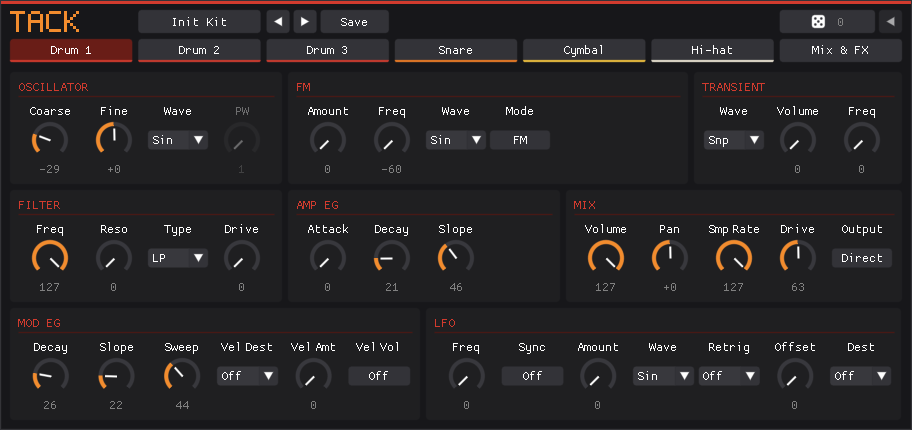
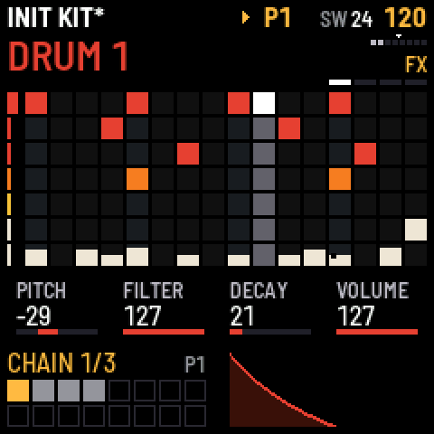
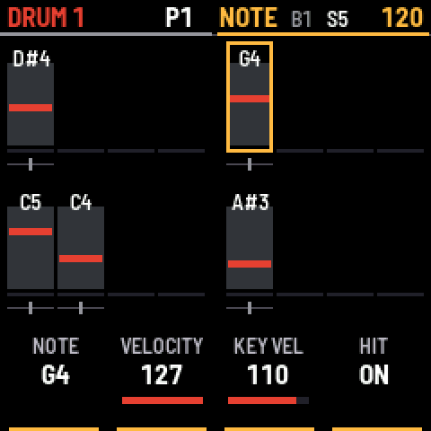
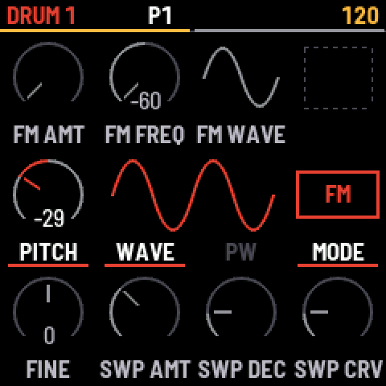

# Tack

Tack is a digital drum synth with seven voices, in two forms: CLAP, VST® 3 and Audio Unit plugins for your DAW, and
firmware for the M-VAVE FM-1, with a step sequencer. Its sound engine is the LXR-02 firmware by Sonic Potions and
Erica Synths, which Tack extends. The engine code under `Core/` is the firmware's, with the fixes and additions listed
in [Changes to the firmware](#changes-to-the-firmware). Tack adds the plugins and their editor, the FM-1 firmware and
the code that runs the engine on a computer. It is made by oikoaudio.

[Download the plugins](https://github.com/oikoaudio/tack/releases/latest) · [Install it on an FM-1](https://oikoaudio.com/tack/fm1/install/) ·
[Try the FM-1 firmware in a browser](https://oikoaudio.com/tack/fm1/try/) · [Website](https://oikoaudio.com/tack/)

<p></p>

<p>



</p>

Tack is not affiliated with or endorsed by Erica Synths, Sonic Potions or M-VAVE.

## Plugins

Tack comes as `Tack.clap`, `Tack.vst3` and, on macOS, `Tack.component`, the Audio Unit. Each holds the
same five plugins.

| Plugin | Plays |
|---|---|
| Tack | The whole kit, which is three drums, snare, cymbal, closed and open hi-hat, and the FX bus. It has seven stereo outputs, Main and one each for the three drums, snare, cymbal and hi-hat. |
| Tack Drum | One drum voice |
| Tack Snare | The snare |
| Tack Cymbal | The cymbal |
| Tack Hi-hat | The closed and open hi-hat |

In Tack, notes on MIDI channel 1 from C3 up trigger the voices, one note each. Channels 2 to 8 each play one voice
chromatically. The single-voice plugins play chromatically on any channel, or at the voice's tuned pitch on every note
when their Chromatic switch is off.

Every sound parameter on the device's front panel is a plugin parameter, 227 in Tack, and the host can automate and
modulate them. Each plugin has its own editor. The editor does not copy the hardware's front panel or its look.

## Kits

Tack loads kit files in the device's `.SND` format, the files the LXR-02 writes to its SD card. Put folders of kits
in the kit folder, `~/.local/share/Tack/Kits/` on Linux (or `$XDG_DATA_HOME/Tack/Kits/` if that is set) and
`Documents/Tack/Kits` on Windows and macOS. Each folder in it is a pack.
Tack lists the kits in its own kit browser, and the CLAP also lists them in the host's preset browser. The single-voice plugins offer the
matching voices of every kit, so Tack Snare lists each kit's snare.

Saving a kit writes a `.SND` file to the `User` pack in the format the device writes, and the device can load it. On
the device's SD card a kit file needs a slot number in its name, such as `05-NAME.SND`. The single-voice plugins save
a kit with only their voice in it. Tack's browser marks such files with the kind of voice, "Clap (Snare)", and
picking one replaces only that voice of the open kit. A drum goes onto the drum tab that is open.

No kits come with Tack. The factory kits and third-party kits belong to their authors.

## Status

Tack works on Linux x86-64 and on an Apple silicon Mac (M1). The CLAP and the VST3 are tested in Bitwig 6.1.6 on
both, and the Audio Unit in Logic Pro. It also builds for Windows. The Windows build renders the same as Linux under
Wine, but nobody has played it in a DAW yet. The VST3 passes Steinberg's validator and Tack's own VST3 tests on Linux
and Windows, and CI checks the Audio Unit with `auval`.

Download the zip for your platform from the [latest release](https://github.com/oikoaudio/tack/releases/latest): Linux
x86-64, Windows x86-64, or macOS for Apple silicon and Intel. Each holds `Tack.clap` and `Tack.vst3`, and on macOS also
`Tack.component`. Copy them to your plugin folders: `~/.clap` and `~/.vst3` on Linux,
`C:\Program Files\Common Files\CLAP` and `VST3` on Windows, and `~/Library/Audio/Plug-Ins/CLAP`, `VST3` and `Components`
on macOS. The macOS build is not signed, so macOS blocks it as downloaded: after copying, clear the download flag with
`xattr -dr com.apple.quarantine ~/Library/Audio/Plug-Ins`. The FM-1 firmware installs from its
[install page](https://oikoaudio.com/tack/fm1/install/) in Chrome or Edge.

Report a problem with the [bug report form](https://github.com/oikoaudio/tack/issues/new?template=bug-report.yml).
Report security problems privately, as [SECURITY.md](SECURITY.md) describes.

## Building from source

You need CMake 3.21 or newer, Ninja, a C and C++ compiler and the OpenGL and X11 development files. Tack is tested
with gcc 15. CMake fetches the CLAP SDK, clap-wrapper, the VST3 SDK, Apple's AudioUnitSDK, pugl and Dear ImGui at pinned
versions, and libsamplerate if it isn't installed.

```sh
cmake -S host -B build/host -G Ninja
cmake --build build/host
cmake --build build/host --target install_tack
```

The last command copies `Tack.clap` to `~/.clap` and `Tack.vst3` to `~/.vst3`. Add `-DTACK_VST3_AU=OFF` to the
first command to build only the CLAP. [host/README.md](host/README.md#windows-and-macos) has the
commands for Windows and macOS.

[host/README.md](host/README.md) is the technical reference. It covers the MIDI note map, parameters and modulation,
outputs and FX routing, how kits load and save, the command-line tools for testing without a DAW, and the bugs fixed in
the firmware code.

## Repository layout

| Path | Contents |
|---|---|
| `host/` | Tack. The desktop build of the sound engine, the plugins, the editor and test tools. |
| `firmware/fm1/` | Tack as firmware for the M-VAVE FM-1, with a step sequencer. See [its README](firmware/fm1/README.md). |
| `engine/` | The engine's control layer, which the plugins and the FM-1 firmware share. |
| `Core/Src/Soundengine/` | The firmware's sound engine, which Tack compiles. |
| `Core/` | The rest of the LXR-02 firmware's source. It no longer builds for the device, and what Tack does not compile may go. |

This repository no longer builds firmware for the LXR-02 itself, as nobody here has one to test on. The
[upstream repository](https://github.com/erica-synths/lxr-desktop-app) does, and this repository's history holds the build as it was.

## Changes to the firmware

Tack changes the LXR-02 firmware's code under `Core/` in the places below. Each row names the commits that made the
change. Rows marked FM-1 sit behind `LXR_FM1_BUILD`, so only the FM-1 firmware compiles them, and the plugins never do.

The repository also leaves out what only the LXR-02's own build needs: the STM32 HAL and CMSIS drivers, the USB-MIDI and
SD card code, FatFs, the linker script and the CMake build for the device (e9d680a). NOTICE.md lists what remains.

### Fixes

These are bugs in the original code, found while running it on a computer. They are in the engine code Tack shares
with the LXR-02, so they may matter there too, but they have only been tested on a computer and on the FM-1.

| Commit | File | Change |
|---|---|---|
| 3d578f9 | `Core/Src/Soundengine/MIDI/MidiParser.c` | Loading a kit wrote one byte far past the end of `midiParser_originalCcValues`. The kit loader sends `PAR_BANK_CHANGE` as CC 0, so the parameter number underflowed to 65535. The parser now indexes with the CC number. |
| bccf2ac | `Core/Src/Soundengine/DSPAudio/FX/Delay.c`, `Delay.h`, `MidiParser.c` | Switching the delay from normal to ping-pong while it ran kept pointers that are only valid in normal mode, and the next samples read and wrote up to index 49150 of the 32768-entry delay buffer. `Delay_setType()` now masks the pointers for the new mode. |
| 05ee9e3 | `Core/Src/Soundengine/DSPAudio/Oscillator.c` | The interpolating wavetable oscillators read one sample past the end of each 1024-sample table, from the next table or past the end of the array. They now wrap to the start of the same table. The init kit renders bit-identically. |
| 3f7b14f | `Core/Src/Soundengine/DSPAudio/FX/Distortion.c` | At full-scale input the diode distortion read one entry past the end of `table_1n914`. It now interpolates from the last pair of entries, which gives the same result. |
| 10566bb | `Core/Src/Soundengine/DSPAudio/Oscillator.c` | Sample playback is compiled out, but a wave above PWM still takes that branch and left the voice's buffer unwritten, so stack memory went through the filter and out. MemorySanitizer showed it on the factory kit ACID. The buffer is now cleared. |
| 5ddc22e | `Core/Src/Soundengine/DSPAudio/FX/Reverb.c` | The reverb's first loop ran through the second loop's all-pass, so one fixed buffer cell reached the output as a steady level. The original code's own comment names `ap[0]`. |
| 818dad9 | `Core/Src/Soundengine/DSPAudio/TiltEq.c` | At the middle of TONE the tilt's corner reached 0 Hz, its low pass stopped following the input, and its last value stayed on the output as a DC offset. The corner now stops at 10 Hz. |
| 1d33c56 | `Core/Src/Soundengine/MIDI/MidiParser.c` | Three legal kit values sent as NRPN controllers wrote up to 128 bytes past `midiParser_originalCcValues`. The handler now ignores a number past 126. |
| 030b62d, ce78e8e, e1039ce | `Core/Src/Soundengine/Sequencer/sequencer.c` | A stored lane length of 0 means 16, and some code divided by the raw value. Every read now goes through `seq_trackLength()`. |
| 030b62d | `Core/Src/Soundengine/Sequencer/clockSync.c` | MIDI Start and the first clock in the same audio block gave no time between pulses, and `sync_calcBpm()` divided by zero. It now returns a tempo of 1 for that case. |
| 560b42b | `Core/Src/Soundengine/DSPAudio/transientGenerator.c` | The transient's samples are signed, and were shifted left by 8, which is undefined for a negative value. They are multiplied by 256, which gives the same result. |

### Additions

| Commit | File | Change |
|---|---|---|
| e1039ce, 24ef310 | `Core/Inc/Soundengine/FxBus.h`, `Core/Src/Soundengine/DSPAudio/FX/Reverb.c`, `Reverb.h`, `VerbTools/AllpassDelay.c`, `VerbModDelay.h`, `MidiParser.c`, `Core/Src/menu/menu.c`, `Core/Inc/menu/MenuText.h`, `menuPages.h` | The reverb, which the original compiles out with `USE_REVERB 0`, is on as FX type 5. It is stereo, with a right output from Dattorro's taps and the early reflections weighted differently on each side. It gains a 24 dB per octave low cut on the dial that set its type, and a high cut on the dial that went to `Reverb_setComposition()`. MIX adds it to the dry sound, which stays as it is, and the early reflections' dial crossfades between them and the late tail. The modulated all-passes read between samples, as the original's length filter left them at a fixed 2048, and move 16 samples each way, and the loop's two all-passes get a gain of 0.35. Those take out the tail's flutter and growl. |
| dca45f4 | `Core/Src/Soundengine/FxBus.c`, `MidiParser.c` | The delay and the reverb share `FX_BUFFER`, and each played what the other left behind. A change from one to the other now clears it, 2048 words a block with the FX off. |
| e1039ce, dca45f4 | `Core/Src/Soundengine/DSPAudio/FX/Delay.c`, `Delay.h`, `MidiParser.c`, `lfo.c`, `MenuText.h` | The delay has two more modes, normal and ping-pong in sync, where TIME picks one of ten fractions of the bar from 1/32 to 1/2 and follows the tempo. A change of mode or tempo during the delay's crossfade keeps the time it was going to. |
| 91c076b, e1039ce, dca45f4 | `Core/Src/Soundengine/DSPAudio/lfo.c`, `lfo.h`, `MidiParser.c`, `MenuText.h` | RETRIG has each voice twice, the second as once. Once, the LFO plays start to end from that voice's hit and finishes on the value the target is set to. An LFO aimed at another LFO's RETRIG picks the voice and leaves once as it was. |
| 91c076b | `Core/Src/menu/Cc2Text.c`, `MidiParser.c` | FX dry/wet is a modulation target, number 229, after every voice's, so the targets kits store keep their numbers. A modulator's value is scaled to the parameter's range of 0 to 100. |
| e863a5a, e3fa93b | `Core/Src/Soundengine/DSPAudio/lfo.c` | A random LFO started by a voice's hit takes a new value with the hit, which reaches the target before the voice starts and holds until the next hit. |
| 24ef310 | `Core/Src/Soundengine/DSPAudio/1PoleLp.c`, `1PoleLp.h`, `DrumVoice.c`, `Snare.c`, `CymbalVoice.c`, `HiHat.c`, `distortion.c`, `mixer.c` | Less work for the same output: a smoothing filter that has reached its input is skipped for the block, and a voice at full sample rate skips the rate reducer. |
| dca45f4 | `Core/Inc/Preset/InitKit.h` | `extern const` instead of `const extern`, for a build without warnings. |
| 030b62d | `Core/Inc/Soundengine/config.h` | FM-1: the FX buffer and the sequencer's data go in the FM-1's large memory region, as they don't fit in its main RAM. |
| 030b62d | `Core/Src/Soundengine/DSPAudio/Oscillator.c` | FM-1: wavetable interpolation multiplies in 32 bits, as the FM-1's core has been seen to corrupt a register with 64-bit multiplies among 16-bit loads. FM's phase offsets convert through a signed integer, which gives what the desktop computes. |
| aa704be, 9e57eb9 | `Core/Src/Soundengine/DSPAudio/mixer.c`, `Core/Src/Soundengine/MIDI/MidiVoiceControl.c` | FM-1: copies of each voice and of the FX return for 10-channel USB audio, and a count of each voice's hits for the key lights. |
| 3d6598a | `Core/Src/Soundengine/FxBus.c` | FM-1: the distortion puts out a steady level with no input, and that exact level comes off its output, so nothing plays at rest. |
| aa704be, 3d6598a | `Core/Src/Soundengine/Sequencer/clockSync.c`, `clockSync.h` | FM-1: one pulse of the sequencer is its own function, so steps can run from a clock counted in audio frames that MIDI clock corrects. |
| 9e57eb9, ce78e8e, 8e162c5, dca45f4 | `Core/Src/Soundengine/Sequencer/sequencer.c`, `sequencer.h`, `Core/Inc/Preset/SeqStep.h` | FM-1: each lane has a direction (forward, reverse, ping-pong, bounce or random), a speed (1, 1/2 or 1/4) and a start step. Nudge moves in single pulses near the grid. Parameter locks, recurrence and lane wraps come from the FM-1's own code. Under external clock the rest of a step plays before the next one starts, and a nudged hit gives way only to a hit on the same lane and pulse. |
| 2d0bd12 | `Core/Src/main.c` | The start-up screen's second line reads "Modified V 1.7" instead of "LXR2 Drums V 1.7". The first line still credits Sonic Potions. |
| 2d0bd12 | `Core/Inc/Soundengine/config.h`, `Core/Inc/main.h` | Builds for a computer (`LXR_HOST_BUILD`) leave out the attributes that place code and data in the STM32's fast memories, since macOS rejects their section names. The device build is unchanged, byte for byte. |

Tack also plays a few things differently from the device. Those changes live in its own code under `host/`, not
in the firmware, and [host/README.md](host/README.md) describes them: the pulse width minimum, the init kit's FX
values and the output routing.

## License

Tack is free software under the GNU General Public License version 3 only, in [LICENSE](LICENSE), with the additional
permission and additional terms under section 7 in [NOTICE.md](NOTICE.md). These are the terms Erica Synths published
the LXR-02 firmware under. It comes without any warranty.

The additional terms apply to Tack as well.

- "Erica Synths", "LXR" and "LXR-02" and their logos are trademarks of Erica Synths. The GPL grants no right to use
  them. Tack uses them only to say where its code comes from and what it is compatible with.
- Modified versions must be marked as modified and must not be presented as official Erica Synths software. Tack is
  a modified version.
- The LXR hardware, including its front panel and appearance, is the property of Erica Synths and is not covered by
  any license in this repository.

The firmware descends from Julian Schmidt's original LXR firmware, copyright 2013 Julian Schmidt, which Sonic Potions
published under its own license, in [LICENSES/SonicPotions-LXR.txt](LICENSES/SonicPotions-LXR.txt). That license
forbids selling the code or using it in a commercial product or activity, requires modified versions to come with
their complete source, and requires its notice, conditions and disclaimer to come with every copy. The LXR-02
firmware's release doesn't say how that license relates to the GPL, so Tack keeps to both.

- Tack is free. It is never sold, bundled with anything paid, or offered behind a paywall.
- Every release comes with its complete source: the repository with fm1-base and felucca-bsp, which the firmware is
  built from, and the libraries built into the plugin.
- Every release includes the Sonic Potions license, the GPL and NOTICE.md, the plugin's zips and the firmware's
  download alike.

If you redistribute Tack or build on it, keep to the same terms.

Third-party code in the repository keeps its own license, listed in [NOTICE.md](NOTICE.md#third-party-components). The
plugin build also fetches the CLAP SDK (MIT), clap-wrapper (MIT), the VST3 SDK (MIT), AudioUnitSDK (Apache 2.0), pugl
(ISC), Dear ImGui (MIT) and libsamplerate (BSD-2-Clause), and each release includes the licenses of those built into
its plugins.

## Credits

Tack is Swedish for **Thank you**.

Tack's sound is the LXR-02's: the voices, the FX bus and the kit format are the work of Sonic Potions and Erica
Synths. The LXR-02 is Sonic Potions' design, made and sold by Erica Synths, who published its firmware at
[github.com/erica-synths/lxr-desktop-app](https://github.com/erica-synths/lxr-desktop-app), copyright 2012-2026
Erica Synths. This repository is a fork of it.

That firmware grew out of the original LXR by Julian Schmidt of Sonic Potions, published at
[github.com/SonicPotions/LXR](https://github.com/SonicPotions/LXR), and many of its source files still carry his name.
The Sonic Potions firmware also has code from Rudeog, Patrick Dowling and Andrew Shakinovsky, whom its README thanks.

Tack's plugin, editor and host code is by oikoaudio, at
[github.com/oikoaudio/tack](https://github.com/oikoaudio/tack). The VST3 and the Audio Unit are made from the CLAP
with [clap-wrapper](https://github.com/free-audio/clap-wrapper) by the CLAP team.

VST is a registered trademark of Steinberg Media Technologies GmbH.
