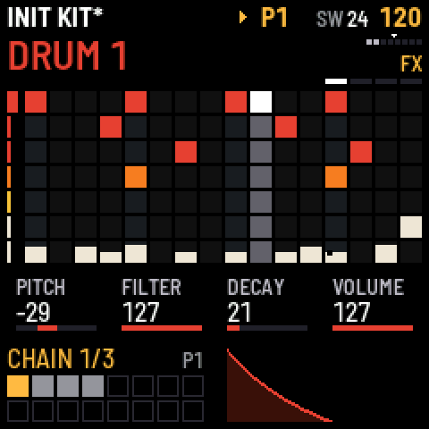
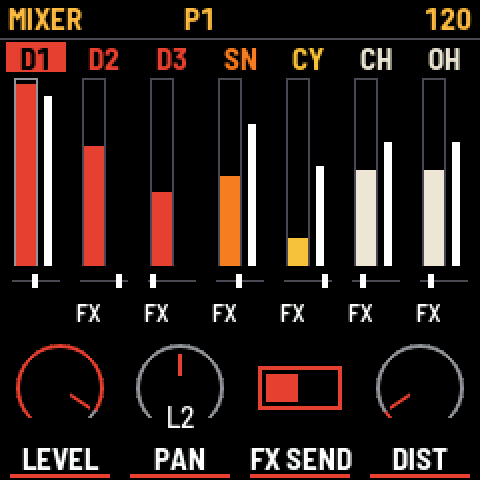
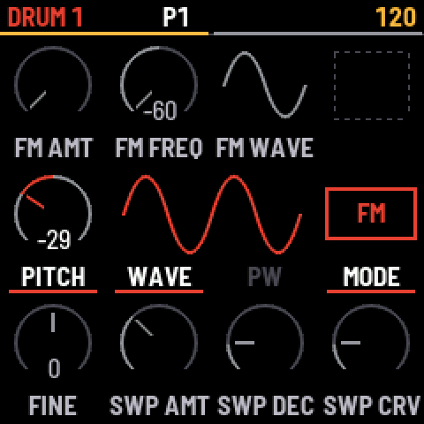

# Tack for the M-VAVE FM-1

Tack replaces the firmware of an M-VAVE FM-1 with a seven-voice drum synth and a step sequencer. It is a whole firmware, so the FM-1's own synth is gone while Tack is on it. The voices, the FX and the sequencer come from the LXR firmware by Sonic Potions and Erica Synths, compiled for the FM-1's chip. The panel and the screens are new.

<p>



</p>

Tack 0.9 is the first release. It has run on an FM-1 throughout its development. The plugins are in [host/](../../host) and share the engine with this firmware.

| | |
|---|---|
| Voices | Three drums, a snare, a cymbal, and closed and open hats, each with its own synth parameters |
| Sequencer | Seven lanes of up to 64 steps, each with its own length, direction, speed and start. Steps have velocity, nudge, flam, chance, recurrence and up to eight parameter locks. Velocity shapes write a rhythm's accents into a lane |
| Patterns | 16 patterns that keep their own kit, chains that loop, and one song of up to 63 rows |
| Sound | Morph between two kits, an FX bus, and sample rate and bit crush. The LXR's reverb is switched on, in stereo, with low and high cuts |
| USB | Stereo or 10 channel audio, MIDI notes, and MIDI clock in |
| Kits | 128 slots for kits in the LXR-02's `.SND` format. None come with Tack |

## A first pattern

1. Install Tack, as below or from [the install page](https://www.oikoaudio.com/tack/fm1/install/) in Chrome or Edge.
2. Press HOME for the overview. One of the first seven black keys picks a voice.
3. Press white keys to set steps on that voice, then press PLAY.
4. Turn K1 to K4 for its pitch, filter, decay and volume.
5. Hold a step and turn a dial to lock that value to the step.
6. Stop, press SAVE to see what it will write, and press it again to write it.

[The manual](https://www.oikoaudio.com/manuals/tack-fm1/) covers every key and page.

## Build

You need the JieLi toolchain and SDK once:

```sh
git submodule update --init --recursive
sh third_party/fm1-base/tools/get_toolchain.sh
SDK_URL=https://github.com/amitv87/fw-AC79_AIoT_SDK sh third_party/fm1-base/bsp/tools/get_sdk.sh
export JIELI_TOOLCHAIN=~/.jieli/toolchain AC79_SDK=~/.jieli/ac79-sdk
```

Then, from the repository root:

```sh
python3 third_party/fm1-base/tools/build.py firmware/fm1                 # firmware/fm1/build/tack.fwsc
CC=clang python3 third_party/fm1-base/tools/build.py firmware/fm1 --host # the simulator
```

## Use a connected FM-1

`tools/fm1` runs the device tools from any folder. Close anything using the FM-1's MIDI port first, and plug it straight into the computer, as a hub can stop it reconnecting during an install.

| Command | What it does |
|---|---|
| `fm1 info` | Shows what is on the unit |
| `fm1 install` | Installs `build/tack.fwsc`, or finishes an install that was cut off |
| `fm1 kits DIR` | Replaces the kit bank with every `.SND` file under `DIR`. The site's kit bank page does the same from a browser |
| `fm1 backup NAME` | Writes the patterns and settings to `NAME.tack`, and the bank to `NAME.kits/` |
| `fm1 restore NAME` | Puts both back, after the FM-1 asks |
| `fm1 log` | Reads the crash log |

Saved patterns load only on a build with the same pattern format.

## Test

```sh
firmware/fm1/tests/verify.sh OUTDIR
```

This builds everything and runs the panel scripts in the simulator, the engine tests and the comparison with the LXR's sequencer. It also checks that the plugins' renders have not changed. Its last line is the verdict, and so is its exit code.

One script can run alone, with `firmware/fm1/build/host/tack_host firmware/fm1/tests/lanes.txt OUTDIR`.

The simulator has the host's whole C library, and the FM-1 has only `memset`, `memcpy` and `memcmp`. `firmware/fm1/tests/libc_check.sh` compiles the app as the FM-1 does, without the JieLi toolchain, so a call like `strlen` fails there and not at the device build. It needs the simulator built first.

## Release and the website

The website is the oikoaudio site repository, `WEB_DIR` below, and a push to its `main` deploys it. Prepare it on a branch, and merge only when the release is out.

1. `bash firmware/fm1/tests/verify.sh OUTDIR` ends in `verify: passed`.
2. Set the version in `host/CMakeLists.txt`. `.github/workflows/release.yml` checks that the tag matches it.
3. Build the release package with `python3 third_party/fm1-base/tools/build.py firmware/fm1 --release X.Y.Z`, which writes `firmware/fm1/build/tack-X.Y.Z.fwsc`. Build the browser emulator with `--web` (needs Emscripten) and the simulator with `--host`.
4. `python3 firmware/fm1/tools/make_web.py X.Y.Z WEB_DIR` writes the install, backup, kit bank and try-it pages' files into the site.
5. `firmware/fm1/build/host/tack_host firmware/fm1/tests/site_shots.txt OUTDIR` takes the manual's screens. Each goes into `WEB_DIR/public/images/` as `tack-NAME-240.png` as it is, and as `tack-NAME.png` scaled 3× to 720 px.
6. `python3 firmware/fm1/tools/docs/make_docs.py OUTDIR WEB_DIR` writes the mode maps and the cheat sheet, with their screens from `tests/doc_shots.txt`. A control that moved or changed its job needs its callout edited in `tools/docs/doc_maps.py` first, and the cheat sheet's text in `tools/docs/cheat_sheet.html`.
7. Bring the manual's text, `WEB_DIR/app/tack-content.tsx`, up to date with any panel change.
8. In `WEB_DIR`, `npm run build:pages` builds the site into `out/`. Look at it from a local server (`python3 -m http.server` in `out/`), commit on the branch, and merge to `main` to publish.

`fm1 install` takes `build/tack.fwsc`, from a normal build, not the release package.

## Layout

| Path | Contents |
|---|---|
| `app.c` | State, start-up, the screen's top level and the frame loop. It includes `app/`, so the compiler sees one file |
| `app/input.c`, `view.c`, `dials.c` | The panel: reading it, which page shows, what each dial does there |
| `app/home.c`, `sound_pages.c`, `screens.c`, `popups.c`, `widgets.c` | Drawing |
| `app/store.c`, `kit_sysex.c`, `lights.c`, `test_hooks.c` | Saving, the kit bank over USB, the lights, the simulator's checks |
| `src/tack_engine.c` | The engine and sequencer behind an event queue, with no hardware in it |
| `src/seq_platform.c` | The sequencer's clock, and stand-ins for the LXR's LEDs, menu and SD card |
| `shim/` | Stand-ins for the STM32 headers and libm |
| `tools/` | The `fm1` commands and the generators of `src/tack_pages.h` and `src/tack_shapes.h` |
| `tests/` | The simulator scripts, engine tests and comparisons |
| `site/` | What goes on the install page, beside what `tools/make_web.py` writes |

Outside this folder, `engine/` is the control layer shared with the plugins, `Core/` is the LXR engine and sequencer, and `third_party/fm1-base` is the platform: audio, MIDI, flash and the simulator.

Only the audio interrupt writes engine and sequencer state. The main loop posts events to a queue, and the render drains it before each 64-frame block.

## Licence

GPL-3.0-only, with the terms in [NOTICE.md](../../NOTICE.md). Tack is not affiliated with or endorsed by Erica Synths, Sonic Potions or M-VAVE.
